<h1 align="center">DBAdvisor - Intelligent Database Observability, Automated Load Testing & Query Optimization Platform</h1>

  A comprehensive, centralized enterprise web platform engineered to modernize, automate, and orchestrate database observability, automated stress testing, and AI-assisted query optimization. Developed for <b>Digital Life Agency</b>.

  
  
  
  
  
  
  
  
  
  

---

## Table of Contents
1. [Executive Summary & Background](#executive-summary--background)
2. [Problem Statement & Objectives](#problem-statement--objectives)
3. [System Architecture & Core Tenets](#system-architecture--core-tenets)
4. [Functional Modules](#functional-modules)
   - [Host Server Management Console](#1-host-server-management-console)
   - [Heterogeneous Database Connection Hub](#2-heterogeneous-database-connection-hub)
   - [Automated k6 Load & Stress Testing Engine](#3-automated-k6-load--stress-testing-engine)
   - [AI-Powered Query Optimization Advisory](#4-ai-powered-query-optimization-advisory)
   - [Central Analytics & Historical Benchmarks](#5-central-analytics--historical-benchmarks)
   - [Security & Dynamic Appearance Customizer](#6-security--dynamic-appearance-customizer)
5. [Technology Stack](#technology-stack)
6. [Demo Pictures](#demo-pictures)
7. [License](#license)

---

## Executive Summary & Background

In modern cloud computing and enterprise software ecosystems, database infrastructure constitutes the foundational backbone supporting business operations. As systems scale to handle increasing transaction volumes and concurrent users, maintaining optimal database performance, verifying operational limits, and rapidly resolving slow queries become critical engineering challenges.

However, traditional database administration workflows have historically suffered from fragmented observability tooling, complex script-driven load testing, and manual query diagnosis.

Conceived and developed for **Digital Life Agency**, a forward-thinking digital engineering firm, **DBAdvisor** delivers a centralized, intelligent web platform that unifies host infrastructure telemetry, multi-database health monitoring, automated performance benchmarking via **k6**, and artificial-intelligence-driven query optimization.

The platform provides DevOps teams, database administrators (DBAs), and software engineers with an end-to-end operational workspace that eliminates CLI complexity, visualizes system behavior in real time, and automates performance validation before production deployment.

---

## Problem Statement & Objectives

### The Traditional Database Engineering Bottlenecks
* **Fragmented Observability Silos:** Administrators must juggle disconnected terminal commands, OS-level utilities, and independent database monitoring dashboards, resulting in delayed incident detection and high cognitive load.
* **Complex and Fragile Load Testing:** Conducting realistic stress testing traditionally requires writing specialized JavaScript test scripts for tools like k6, configuring runtime environments, and manually parsing raw terminal outputs.
* **Laborious Slow-Query Diagnosis:** Identifying performance bottlenecks often demands manual inspection of complex SQL execution plans, schema structures, and indexing hierarchies without automated recommendations.
* **Inconsistent Multi-Database Management:** Heterogeneous environments mixing PostgreSQL, MySQL, and MongoDB lack a unified operational control panel with standardized health telemetry.

### Strategic Platform Objectives
* **Centralized Multi-Host Fleet Management:** Enable administrators to register and oversee remote host servers with real-time metrics collection (CPU, RAM, disk, network reachability).
* **Scriptless k6 Performance Testing:** Empower teams to configure, launch, and monitor concurrent load tests through an intuitive visual interface with dynamic virtual users (VUs) and stage orchestration.
* **AI-Assisted Query Optimization Engine:** Automatically analyze slow query strings, explain execution plans, and generate concrete indexation strategies and optimized query rewrites.
* **Unified Multi-Database Connectivity:** Provide seamless credential management and instant latency testing across PostgreSQL, MySQL, and MongoDB instances.
* **Enterprise Security and Ergonomics:** Enforce robust role-based authentication with Clerk, protect sensitive connection strings, and offer customizable visual themes for optimal developer experience.

---

## System Architecture & Core Tenets

DBAdvisor is built on a decoupled, three-tier modular architecture designed for high availability, fault tolerance, and responsiveness:

* **Presentation Tier (Next.js 14 & React):** Implemented using the Next.js App Router, React Server Components, and Tailwind CSS with shadcn/ui. Provides a responsive single-page experience with optimistic UI updates and customizable themes.
* **Application Logic Tier (Node.js & Express):** A resilient RESTful API server responsible for host health telemetry, database probing, k6 subprocess lifecycle management, and communication with AI advisory services.
* **Persistence Tier (MongoDB):** A document-oriented database providing flexible schema storage for server inventories, database credentials, benchmark results, and AI query analyses.

### Key Architectural Tenets
* **Strict Decoupling:** Complete separation between the Next.js frontend client and the Express backend API ensures independent scalability and zero render-blocking operations.
* **Asynchronous Process Isolation:** Long-running k6 load tests execute in dedicated subprocesses, streaming metrics back via WebSockets/REST endpoints without degrading dashboard responsiveness.
* **Defense-in-Depth Security:** Integration of Clerk identity management, environment-level secret isolation, and client-side input validation safeguards operational integrity.

---

## Functional Modules

### 1. Host Server Management Console
* **Server Inventory Registry:** Register and catalog on-premise and cloud servers by IP address, SSH port, operating system, and deployment environment.
* **Live System Telemetry:** Monitor real-time hardware indicators including CPU core utilization, memory consumption, storage headroom, and ping round-trip times.
* **Fleet Health Indicators:** Instant visual statuses (`Online`, `Offline`, `High Latency`) providing an immediate overview of host availability.

### 2. Heterogeneous Database Connection Hub
* **Multi-Database Support:** Native connection adapters for PostgreSQL, MySQL, and MongoDB.
* **Connection Health Probing:** Real-time ping testing verifying database listener reachability and connection handshake latency.
* **Metadata & Schema Inspection:** Inspect database versions, active connections, table inventories, and collection sizes directly from the web console.

### 3. Automated k6 Load & Stress Testing Engine
* **Visual Workload Configuration:** Set test duration, target concurrency, ramp-up stages, and target endpoints without writing k6 test scripts.
* **Live Execution Telemetry:** Real-time streaming graphs displaying requests per second (RPS), round-trip latency, error percentages, and percentile distributions (p90, p95, p99).
* **Automated Threshold Validation:** Define pass/fail SLA criteria (e.g., p95 latency < 500ms, error rate < 1%) verified automatically upon test completion.

### 4. AI-Powered Query Optimization Advisory
* **Query Ingestion Desk:** Submit slow SQL queries or MongoDB aggregation pipelines alongside execution plan outputs.
* **Intelligent Diagnostic Breakdown:** The AI engine identifies full table scans, Cartesian joins, missing index opportunities, and high-cost operators.
* **Actionable Tuning Recommendations:** Generates structured indexing advisories, schema adjustment hints, and syntactically validated optimized query alternatives.

### 5. Central Analytics & Historical Benchmarks
* **Executive Summary Dashboard:** Aggregated operational metrics displaying total managed servers, active database connections, completed load tests, and system health status.
* **Historical Benchmark Archive:** Browse, filter, and inspect past performance test campaigns to compare latency baselines and detect regressions over time.
* **Detailed Metric Breakdowns:** Drill down into comprehensive test reports featuring request distributions, timeline graphs, and raw metric telemetry.

### 6. Security & Dynamic Appearance Customizer
* **Clerk Identity Management:** Secure authentication flows with session management, multi-device tracking, and enterprise access control.
* **Real-Time Theme Customizer:** Powered by tweakcn, allowing users to customize color palettes, toggle dark/light modes, adjust border radii, and personalize the interface.

---

## Technology Stack

| Layer | Technologies | Key Capabilities |
| :--- | :--- | :--- |
| **Frontend Framework** | Next.js 16, React 19 | App Router, Server Components, Fast Refresh, Route Handlers |
| **Styling & Design System** | Tailwind CSS, shadcn/ui, tweakcn | Modern accessible UI, Radix primitives, dynamic theming |
| **Backend Runtime** | Node.js 20, Express.js | High-throughput asynchronous REST API, child process execution |
| **Platform Persistence** | MongoDB, Mongoose ODM | Flexible document modeling, fast indexing, telemetry storage |
| **Performance Testing** | Grafana k6 | Scriptable high-load generation, sub-millisecond metric precision |
| **Authentication & Auth** | Clerk Auth | Enterprise identity, JWT verification, session management |
| **DevOps & Containerization** | Docker, NGINX | Containerized service isolation, reverse proxy, SSL termination |

---

## Demo Pictures

|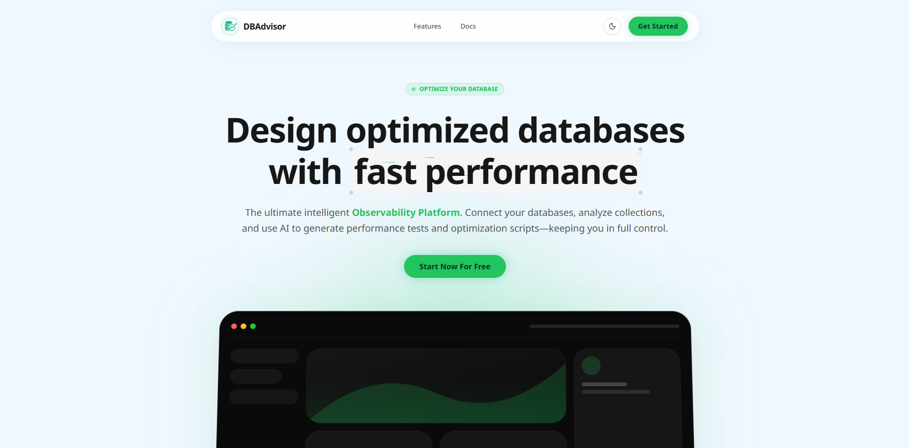|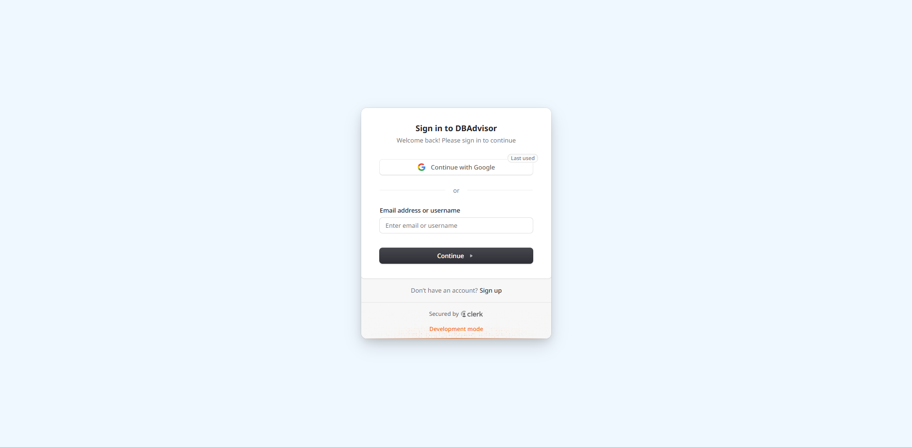|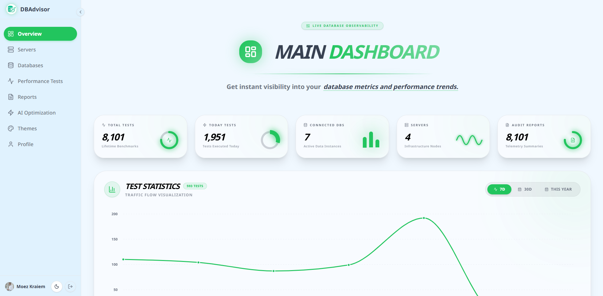|
|:---:|:---:|:---:|
|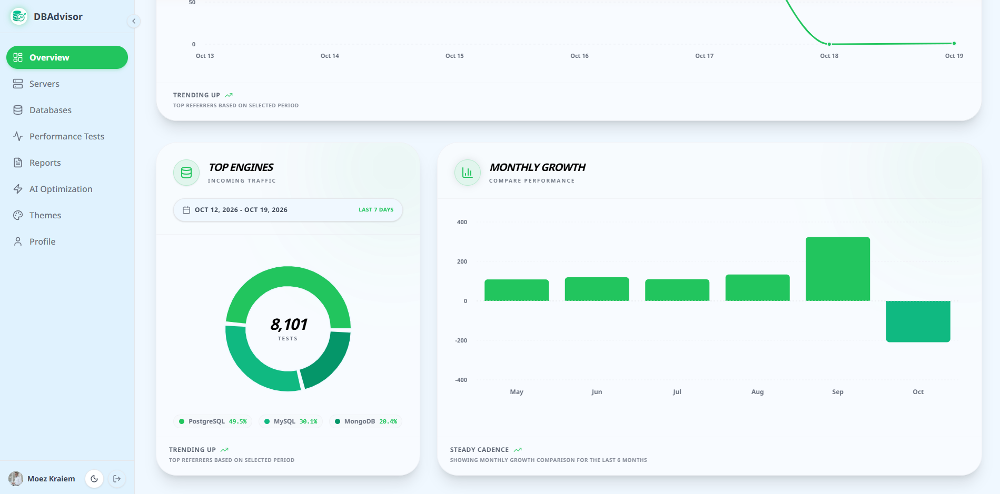|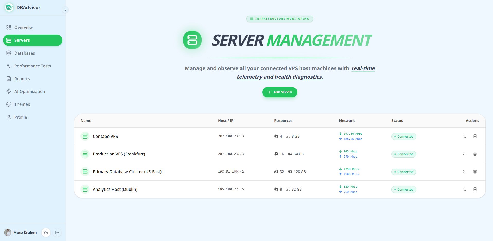|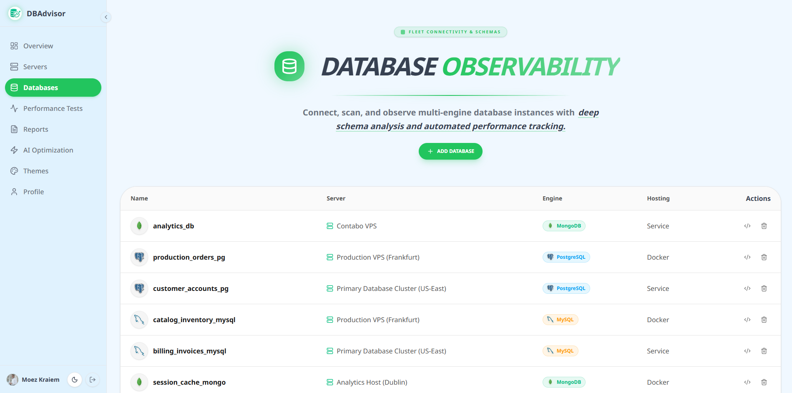|
|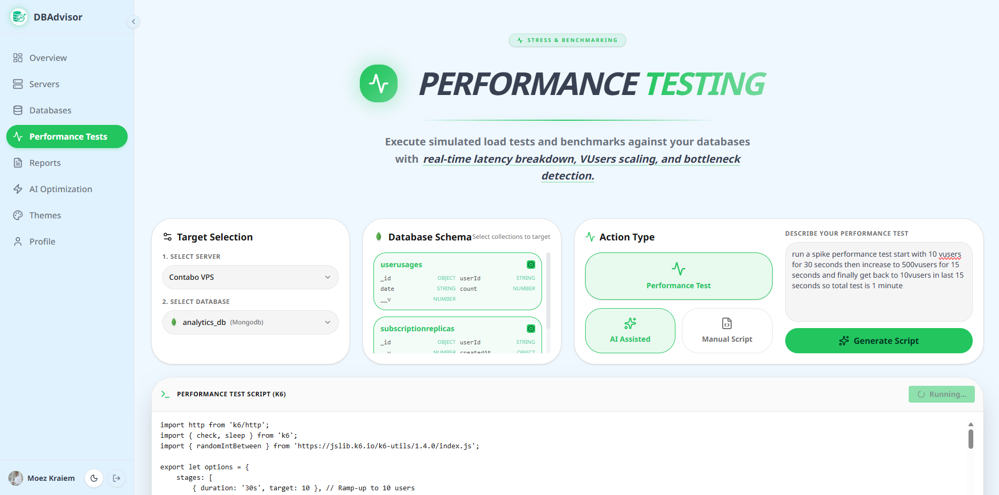|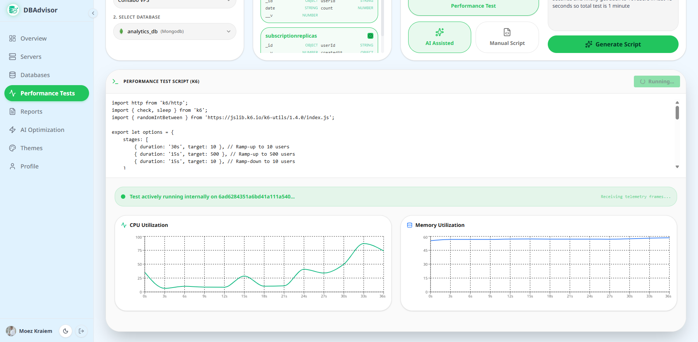|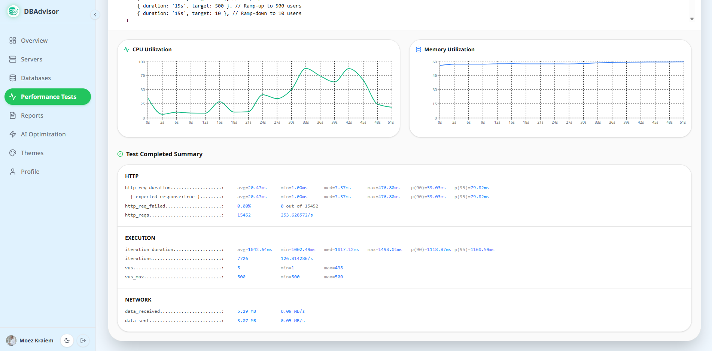|
|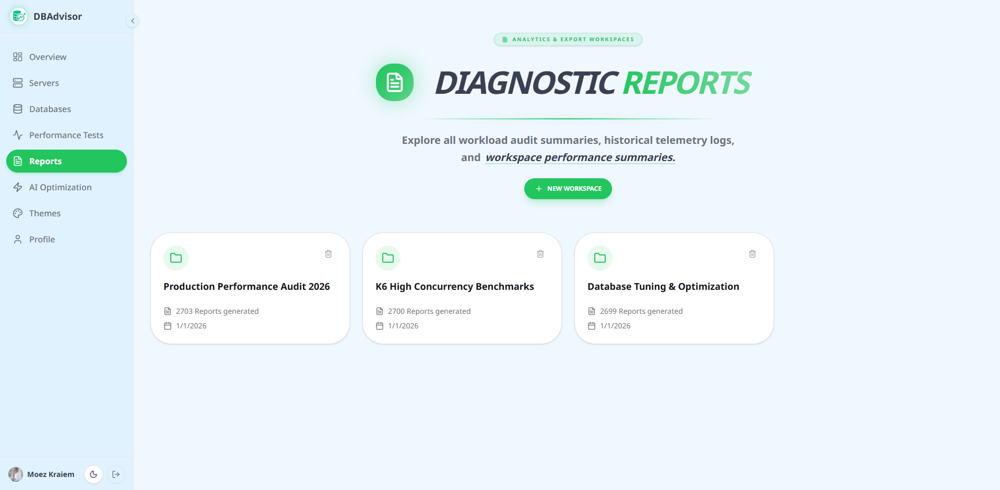|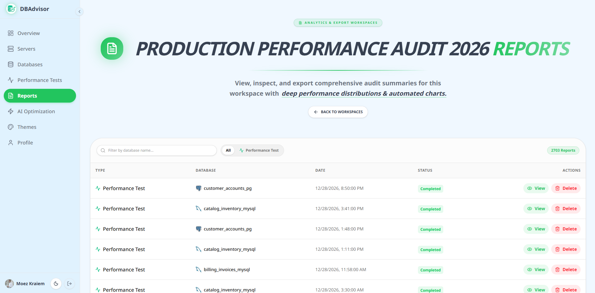|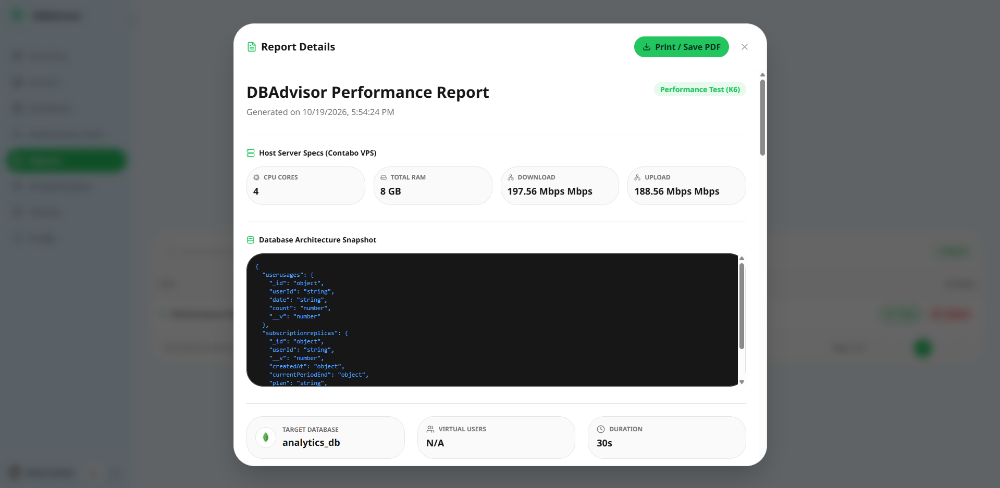|
|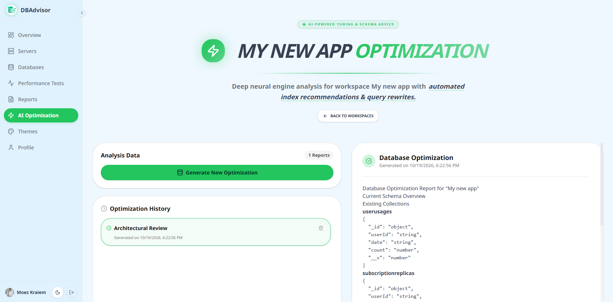|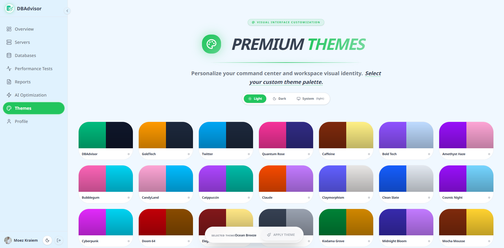|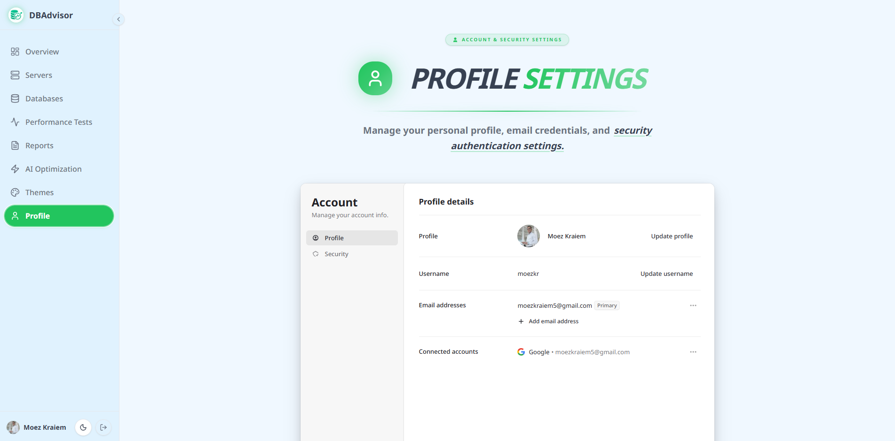|

---
